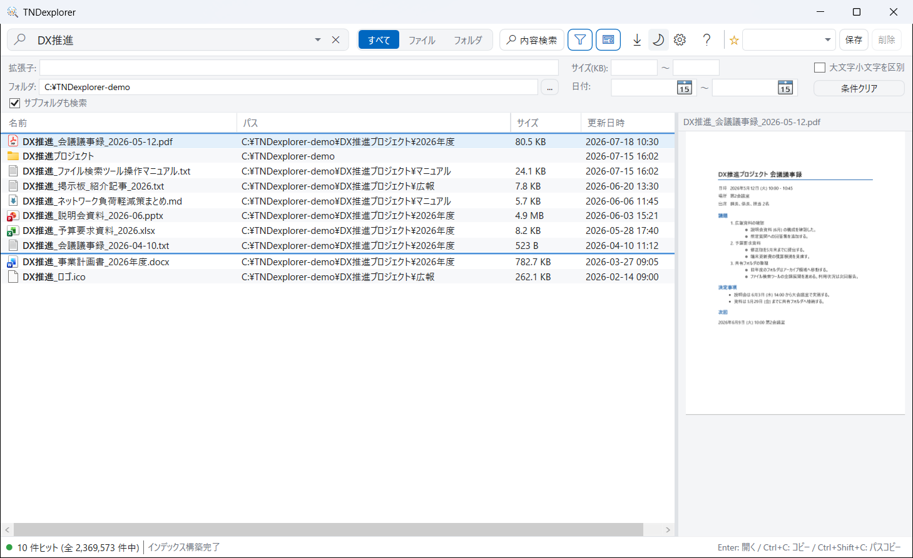
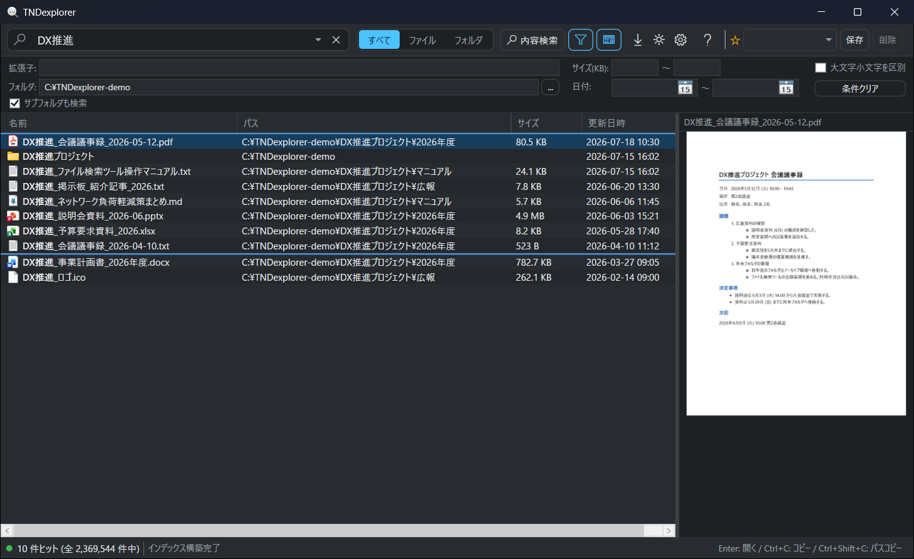
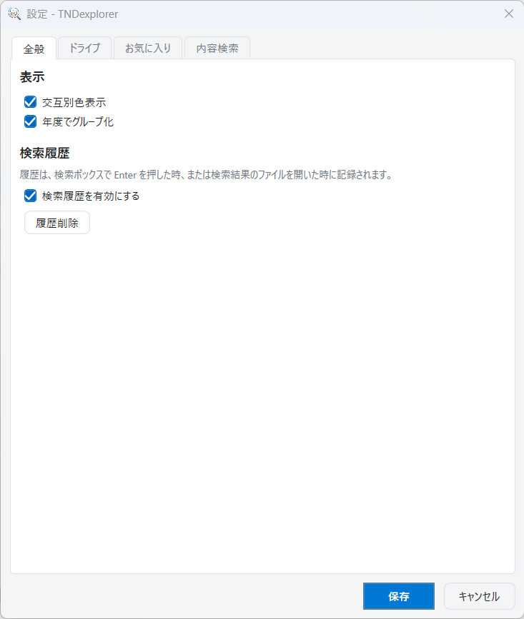
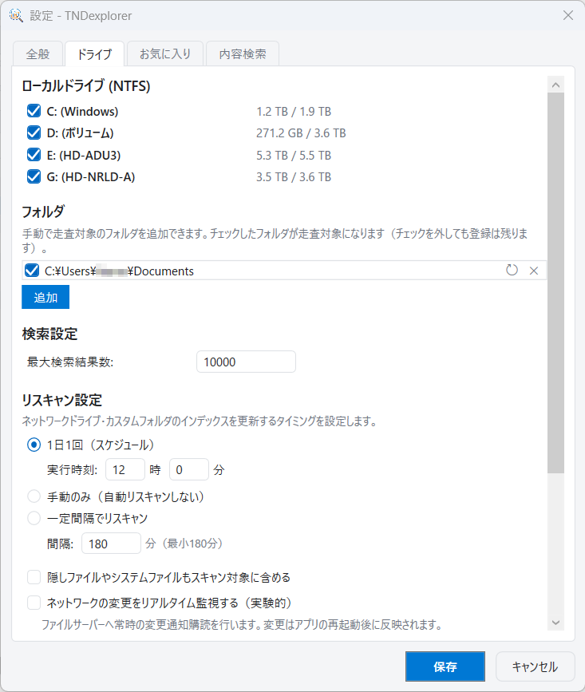
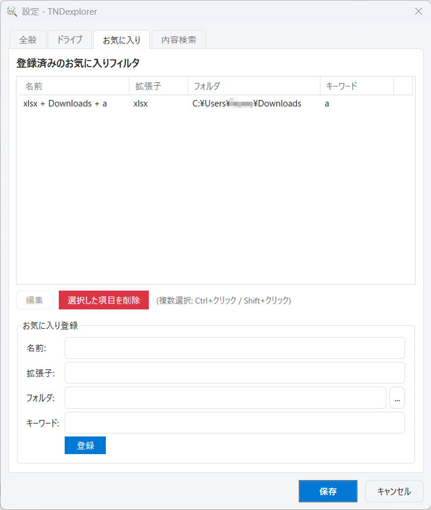
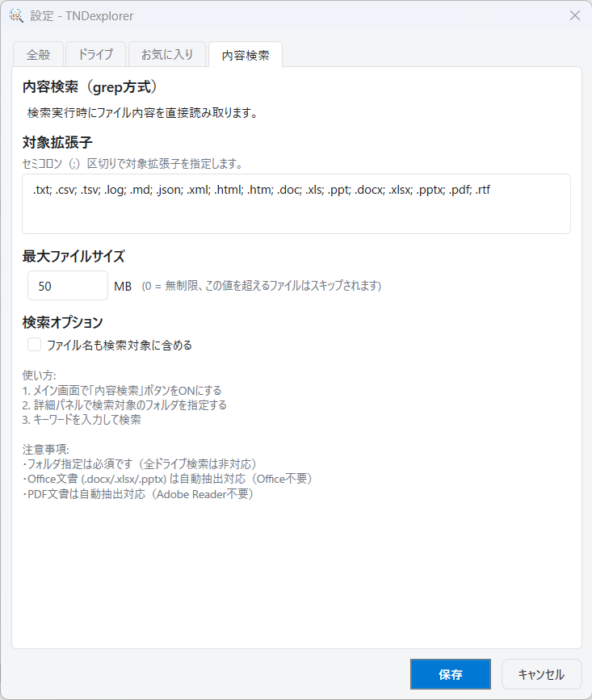

# TNDexplorer

**NTFS の MFT を直接読み取る、超高速ファイル検索ツール (Windows)**

数百万件のファイルをキーワード入力と同時に検索し、ネットワーク共有フォルダの検索、
ファイルの中身を読む内容検索、PDF / 画像 / Office 文書のプレビューまでを
単一 EXE (外部依存なし) で提供します。



## 特徴

- **瞬時に検索** — NTFS Master File Table (MFT) を直接読み取ってインデックスを構築し、USN Journal で変更をリアルタイム追従。入力するそばから結果が絞り込まれます。
- **ネットワーク共有にも対応** — UNC パス (`\\server\share`) やドライブレター (`K:\`) で共有フォルダを登録。スキャン結果はキャッシュされ、1 日 1 回 / 一定間隔 / 手動のリスキャンを選べます。
- **内容検索 (grep 方式)** — 事前インデックス不要で、テキスト / Word / Excel / PowerPoint / PDF の中身をその場で並列スキャン。Office のインストールは不要です。
- **プレビュー** — PDF (全ページ)、画像、Office 文書、テキストを検索結果の右側に表示。
- **柔軟な検索構文** — AND / OR / 除外 / 拡張子指定を組み合わせ、詳細パネルでフォルダ・サイズ・日付を絞り込み。
- **業務向けの操作性** — お気に入り条件、検索履歴、CSV 出力、複数選択コピー、年度グループ表示、ライト / ダークテーマ。
- **単一 EXE** — 約 800 KB の実行ファイル 1 つ。.NET Framework 4.8 (Windows 10 1903 以降に標準搭載) 以外に必要なものはありません。

上の画面は、詳細パネルでフォルダを絞り込み、`DX推進` で検索した結果から PDF を選んでプレビューしているところです。

<details>
<summary>ダークテーマ</summary>



</details>

## 動作要件

- Windows 10 / 11 (x64)
- .NET Framework 4.8
- 管理者権限 (NTFS MFT の読み取りに必要。起動時に UAC の確認が表示されます)

## インストールと起動

1. [Releases](https://github.com/HTanoda/TNDexplorer/releases) から `TNDexplorer.exe` をダウンロードし、任意のフォルダに置きます。
2. ダブルクリックで起動し、UAC の確認で「はい」を選びます。
3. 初回起動時の初期設定ウィザードで、インデックス対象のローカルドライブ (NTFS) を選んで「開始」を押します。
   - インストールにより Windows の「プログラムと機能」に登録されます (資産管理ツールから検出可能)。
   - ネットワーク共有フォルダは起動後に **[設定] → [ドライブ] → [フォルダ]** から追加できます。

設定は `%LOCALAPPDATA%\TNDexplorer\` に保存されます。
アンインストールは「設定 > アプリ」から、またはコマンドラインで `TNDexplorer.exe --uninstall` を実行します (EXE 本体は手動で削除してください)。

## 使い方

1. 起動するとインデックスの構築が始まります (進捗はステータスバーに表示)。
2. 上部の検索ボックスにキーワードを入力すると、結果がリアルタイムに表示されます。
3. 結果をダブルクリック (または Enter) でファイルを開きます。右クリックで「フォルダを開く」「フルパスをコピー」「ファイルをコピー」「プロパティ」が使えます。

### 検索構文

| 書き方 | 意味 | 例 |
| --- | --- | --- |
| `A B` | A と B の両方を含む (AND) | `report 2024` |
| `A\|B` | A または B (OR) | `ext:txt\|ext:doc` |
| `ext:xxx` | 拡張子を指定 (`;` で複数) | `ext:jpg;gif;png` |
| `!A` | A を含むものを除外 | `report !backup` |

OR は AND より先に評価されます。`ext:txt|ext:doc report` は「(.txt または .doc) かつ report を含む」です。

### 詳細検索

ツールバーのフィルタボタンで詳細パネルを開き、拡張子・サイズ (KB)・更新日時の範囲・対象フォルダ (サブフォルダ含む / 含まない)・大文字小文字の区別で絞り込めます。

### 内容検索

ツールバーの **[内容検索]** を ON にすると、ファイル名ではなくファイルの中身を検索します。
詳細パネルで対象フォルダを指定し、キーワードを入力して Enter を押してください。

- 対応形式: テキスト系 (.txt, .csv, .log, .xml, .json, .html など) / Word (.docx) / Excel (.xlsx) / PowerPoint (.pptx) / PDF (テキストベース) / IFilter 対応形式 (Office がある場合)
- 対象拡張子と最大ファイルサイズ (既定 50 MB) は **[設定] → [内容検索]** で変更できます。
- ネットワークフォルダに対して実行するとファイルサーバーに負荷がかかるため、実行前に確認ダイアログが表示されます。

### プレビュー

ツールバーの **[プレビュー]** で右側のパネルを表示し、結果を選択するとその場で内容を確認できます。
PDF は Windows 組み込みの `Windows.Data.Pdf` で描画するため Adobe Acrobat は不要です。Office 文書は対応するプレビューハンドラーがある環境で表示されます。

### お気に入り / 履歴 / 出力

- **お気に入り**: 現在の検索条件を [保存] で登録し、★ のドロップダウンから呼び出せます。
- **検索履歴**: 検索ボックスの ▼ から過去の検索語 (最大 20 件) を再利用できます。[設定] → [全般] で無効化できます。
- **CSV 出力**: 表示中の検索結果を CSV に保存します。

### キーボードショートカット

| キー | 動作 |
| --- | --- |
| `Ctrl + F` | 検索ボックスをクリアしてフォーカス |
| `Esc` | 検索ボックスをクリア |
| `Enter` | 選択したファイルを開く |
| `Ctrl + C` | 選択したファイルをコピー |
| `Ctrl + Shift + C` | フルパスをコピー |

## 設定

| タブ | 内容 |
| --- | --- |
| 全般 | 交互別色表示、年度グループ化、検索履歴の有効 / 無効と履歴削除 |
| ドライブ | ローカル NTFS ドライブの有効 / 無効、走査対象フォルダ (ネットワーク共有など) の追加と行単位のリスキャン / 削除、最大検索結果数、リスキャン方式 (1 日 1 回 / 手動 / 一定間隔)、隠し・システムファイルの扱い、ネットワーク変更のリアルタイム監視 |
| お気に入り | お気に入りフィルタ (拡張子・フォルダ・キーワード) の登録 / 編集 / 削除 |
| 内容検索 | 対象拡張子、最大ファイルサイズ、ファイル名も検索対象に含めるか |

| 全般 | ドライブ |
| --- | --- |
|  |  |

| お気に入り | 内容検索 |
| --- | --- |
|  |  |

## ビルド

- Visual Studio 2022 以降 (.NET Framework 4.8 開発ツール) と NuGet
- `dotnet build` ではなく MSBuild を使います。

```bash
nuget restore TNDexplorer.sln
MSBuild.exe TNDexplorer.sln -p:Configuration=Release "-p:Platform=Any CPU"
```

出力: `src\TNDexplorer\bin\Release\TNDexplorer.exe`

## 技術情報

- C# / WPF (.NET Framework 4.8)、MVVM
- `FSCTL_ENUM_USN_DATA` による MFT 列挙と USN Journal 監視 (P/Invoke)
- 並列ブルートフォース検索エンジン。検索結果のソートはバックグラウンドで実行
- ネットワークフォルダは `FindFirstFile` 列挙 + ユーザートークンの偽装 (UAC 昇格環境でもログオンユーザーのドライブマッピングを解決)
- ネットワークインデックスは独自バイナリ形式でキャッシュし、アトミック書き込みで破損を防止
- 内容検索: OpenXML 直接解析 (Office 不要)、PDF テキスト抽出 (FlateDecode + ToUnicode CMap)、IFilter フォールバック
- 運用ログ: `%LOCALAPPDATA%\TNDexplorer\logs\app-YYYYMMDD.log` (14 日で自動削除)

## 更新履歴

最新版は **v1.3.1.2** (2026-07-15) です。詳細な履歴は [README.txt](README.txt) の「更新履歴」を参照してください。

## ライセンス

MIT License — Copyright (c) 2026 HIROKI TANODA (TND)
